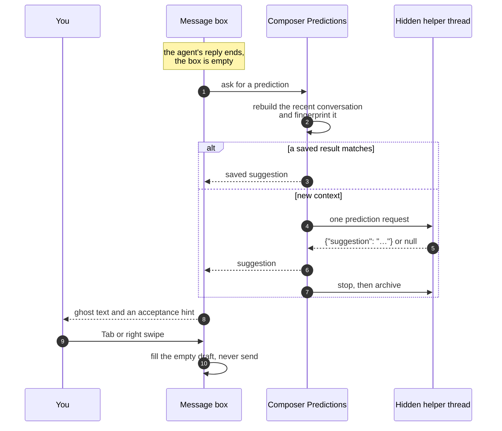

<div align="center">


# Composer Predictions

### Your next message, one gesture away.

Suggests what you are likely to type next, as ghost text in an empty BB message box.<br>
Press Tab or → (or swipe right) to make it an editable draft. Nothing is ever sent for you.


[Features](#features) · [Install](#install) · [How it works](#how-it-works) · [Safety](#safety-and-cost) · [CLI](#cli) · [Settings](#settings) · [Development](#development) · [Design notes](docs/DESIGN.md)

<br>


</div>

<br>

> [!NOTE]
> The screenshots are real BB captures of a demo thread in a throwaway project.

## The problem

Your agent has just replied, and what you type next is often obvious: *make
it shorter*, *now run the tests*, *go with the second option*. You still type
it out, every time.

Composer Predictions reads the conversation after each reply and suggests the
message you are most likely to send next, as faint text in the empty message
box. Press **Tab**, or swipe right inside it on a touchscreen, and it becomes
an ordinary draft you can edit. Start typing and it gets out of the way.

|  | Without Composer Predictions | With Composer Predictions |
| --- | :---: | :---: |
| A suggested next message after each reply | ❌ | ✅ as ghost text |
| Insert it as an editable draft | ❌ | ✅ Tab or right swipe |
| Choose which model predicts | — | ✅ the conversation's, or your own |
| Remember suggestions across restarts | — | ✅ checked before showing |
| Send anything on your behalf | — | ❌ never |

## Features

<table>
<tr>
<td width="50%" valign="top">

### ⌨️ Tab or swipe to insert

Plain **Tab** or **→** fills the empty box with the suggestion and focuses it. It is a
normal draft: edit it, send it, or delete it. **Shift+Tab** keeps its usual
focus behaviour. On a touchscreen, swipe right inside the empty message box
to accept the visible suggestion, including the padding around the text. While
a suggestion is visible, that text area is reserved for autocomplete instead
of BB’s sidebar gesture. Vertical scrolling and pinch zoom keep their usual
behaviour. The gesture inserts a draft only; it never sends.

</td>
<td width="50%" valign="top">

### 👻 Out of your way

Typing, pasting or **Escape** hides the suggestion, and it stays hidden until
the conversation moves on. Nothing shows while the thread is running or the
draft has text, mentions or attachments.

</td>
</tr>
<tr>
<td valign="top">

### 🧠 Your choice of model

By default it uses the conversation's own provider and model at low reasoning
effort. Or pick a separate provider, model, effort and service tier with BB's
native picker.

</td>
<td valign="top">

### 💾 Survives restarts

Suggestions, abstentions and dismissals are saved. After a restart each is
checked against the current conversation first, so an unchanged thread costs
no new request.

</td>
</tr>
<tr>
<td valign="top">

### 🤐 Silent when unsure

When no useful user action is supported, the model is instructed to suggest
nothing. It should not repeat work the agent has promised, started or finished.

</td>
<td valign="top">

### ♿ Announced to screen readers

A polite live region reads out the suggestion and its acceptance controls
whenever one is available.

</td>
</tr>
</table>

<div align="center">
<table>
<tr>
<td align="center"><br><sub><b>One Tab later: an editable draft, not sent</b></sub></td>
<td align="center"><br><sub><b>Settings, with a separate prediction model</b></sub></td>
</tr>
</table>
</div>

## Install

```sh
bb plugin install git:https://github.com/MacHatter1/bb-plugin-composer-predictions --yes
```

Predictions start right away. After the next reply, leave the message box
empty for a few seconds.

<details>
<summary><b>Install from a local clone</b></summary>

```sh
git clone https://github.com/MacHatter1/bb-plugin-composer-predictions
cd bb-plugin-composer-predictions
npm install && bb plugin build
bb plugin install path:$PWD --yes
```

</details>

**Requirements**

- bb **0.46+** (Plugin SDK 0.6.49+)
- The prediction model available on the conversation's machine. A provider
  that can approve automatically runs the helper unattended. A provider that
  asks for approval can be used too: the helper opens beside the conversation
  when it needs a decision. Full Access, which never asks, is not used.

## Where to find it

| Where | What |
| --- | --- |
| **The message box** in an existing thread | Ghost text with a **Tab / →** or **Swipe →** hint once a suggestion is ready. **Tab**, **→** or a right swipe inserts it; **Escape** hides it. New-thread composers are not covered. |
| **Settings → Plugins → Composer Predictions** | The on/off switch, the conversation budget, and the **Prediction model** section. |

## How it works



- **One hidden request.** Each prediction runs in a hidden helper thread in
  the conversation's environment. It returns one line of up to 240
  characters, or nothing. The helper is stopped and then archived as soon as
  its answer is used or the conversation moves on, including at the provider
  when that provider supports archive. A slow archive does not delay the
  suggestion. If the provider cannot approve automatically, an approval opens
  that helper beside the conversation and the suggestion waits until you
  answer.
- **Bounded context.** The input is rebuilt from up to 400 recent events:
  your messages, the agent's replies and completed tool records. Reasoning and
  binary data are left out, and the whole is capped at the conversation budget.
- **Remembered, not reused blindly.** A fingerprint covers the conversation,
  the prompt, the model and the budget. A saved result is shown only when the
  fingerprint still matches.
- **Painted beside the editor.** BB has no ghost-text slot yet, so the overlay
  relies on BB 0.46 composer markup. If it cannot find its own composer, it
  shows nothing and leaves Tab alone.

Context limits, cache rules, key handling and compatibility are covered in
**[docs/DESIGN.md](docs/DESIGN.md)**.

## Safety and cost

- ✋ **Never sends.** Tab or a right swipe fills an empty draft through BB's
  public composer API. The plugin has no call to submit a message.
- 🧾 **Never overwrites.** A suggestion is inserted only when the box has no
  text, mentions or attachments.
- 🧵 **Leaves your thread alone.** Predictions run in separate hidden helpers,
  never in your conversation. Helpers left behind by a crash are cleaned up on
  the next start. BB helpers are deleted after the source conversation moves on,
  with stop and archive completed first.
- 💸 **Costs a model request per new reply.** Normal provider usage applies. A
  thread is watched from the first time you open it with an empty message box
  until it is archived or deleted, or the plugin restarts. Each later reply
  there costs one request, even when you are not looking at that thread. At
  most two helpers run at once, and a saved result for an unchanged
  conversation is reused.
- 📤 **Sends your conversation to the prediction model.** Each request carries
  up to the conversation budget (48,000 characters by default) of recent
  messages and tool output. With the default model, that is the provider the
  conversation already uses. If you choose a separate model, its provider
  receives it too.
- 🗄️ **Stores no copy of your conversation.** The plugin's database keeps the
  suggestion, its status and a fingerprint. BB itself keeps each helper's
  history, including the quoted conversation, as an archived hidden thread
  until the conversation moves on; the plugin then uses BB's normal thread
  deletion to remove the helper. Provider-side sessions are archived where
  supported; this does not permanently delete them from the provider.
- ⚠️ **Not a sandbox.** The helper is told not to use tools and to treat the
  conversation as quoted data. A provider that can approve automatically runs
  it in `auto` and the helper is stopped if it asks for approval or input.
  A provider that cannot is run in the mode that asks, and that approval is
  shown to you. The plugin cannot remove BB's core tools or other plugins'
  tools from the helper.

## CLI

`bb composer-predictions <command> <thread-id> [--json]`. Without `--json`, a
command prints the suggestion, or the status when there is none.

```sh
bb composer-predictions show <thread-id>           # the suggestion, or its status
bb composer-predictions show <thread-id> --json    # the full prediction state
bb composer-predictions regenerate <thread-id>     # discard it and predict again
bb composer-predictions dismiss <thread-id>        # hide the current suggestion
```

<details>
<summary><b>All commands and statuses</b></summary>

| Command | Does |
| --- | --- |
| `show <thread-id>` | Prints the current state. Starts nothing. |
| `regenerate <thread-id>` | Discards the current and saved result and starts a new prediction. Returns at once, usually with `generating`. |
| `dismiss <thread-id>` | Hides the current suggestion until the conversation changes. |

| Status | Meaning |
| --- | --- |
| `ready` | A suggestion is waiting in the message box. |
| `generating` | A helper is working on it. |
| `abstained` | The model chose to suggest nothing. |
| `dismissed` | Typed over, hidden, or accepted. |
| `error` | The prediction failed; `bb plugin logs composer-predictions` has the cause. |
| `idle` | Nothing to predict yet, such as while the thread is running. |

</details>

There are no agent tools. The bundled
[skill](skills/composer-predictions/SKILL.md) teaches agents to read,
regenerate or clear a thread's suggestion when you ask why one is or isn't
showing.

## Settings

`bb plugin config composer-predictions`, or **Settings → Plugins → Composer
Predictions**.

<details>
<summary><b>All settings</b></summary>

| Setting | Default | |
| --- | --- | --- |
| `enabled` | `true` | Suggest a next message in empty thread composers. |
| `contextCharacters` | `48000` | Most characters of conversation sent for each prediction (4,000–120,000). |

The **Prediction model** section is set in the app, not with `bb plugin
config`. **Choose a separate model** opens BB's provider and model picker, and
**Save prediction model** keeps it across reloads. **Use conversation model**
goes back to the default. Changing a setting or the prediction model clears
saved predictions, without touching any draft.

The chooser tries available providers in order and uses the first usable
model, preferring that provider's default. Failed catalogues are reported in
settings and `bb plugin logs composer-predictions`, even when another provider
works. **Retry** refreshes discovery. A fallback is only a picker default;
it becomes your prediction model when you explicitly save it.

</details>

<details>
<summary><b>Turning it off</b></summary>

```sh
bb plugin config composer-predictions set enabled false   # keep the plugin, stop predictions
bb plugin disable composer-predictions                     # unload it entirely
bb plugin enable composer-predictions
```

`bb plugin remove composer-predictions` removes the plugin and its settings.

</details>

## Development

```sh
npm install
npm test                           # Node.js 24+
npm run typecheck
bb plugin build
bb plugin install path:$PWD --yes
bb plugin dev                      # rebuild and reload on every save
```

```
server.ts           wires the coordinator to bb: settings, events, RPC, CLI, helpers, startup cleanup
app.tsx             the composer bridge, the ghost-text content script, the settings section
model-settings.tsx  the Prediction model section
contract.ts         the typed RPC contract and shared schemas
lib/                prompt and parser, coordinator, SQLite cache, ghost overlay
skills/             the bundled agent skill
docs/               logo, design notes, per-release review records
```

**Tests** use `node:test` through `tsx`. Unit tests cover context building,
strict parsing and the coordinator's cancellation, concurrency and
stale-dismissal rules. The ghost overlay's keyboard and touch handling and cleanup run in
jsdom. The composer bridge and settings section run through BB's frontend SDK
harness, and the server, helper cleanup, model routing and reloads through its
fake plugin host, with a real SQLite file for the cache.

The optional [prompt evaluation](docs/prediction-evaluation.md) compares a
baseline Git revision with the current prompt using labelled cases and
independent model requests. It is separate from `npm test`.

`PLUGIN_OVERVIEW.md` is the store listing. Keep it in step with
`bb.description` in `package.json`. Review and verification records for each
release are in [docs/reviews/](docs/reviews/).

## Licence

[MIT](LICENSE)
